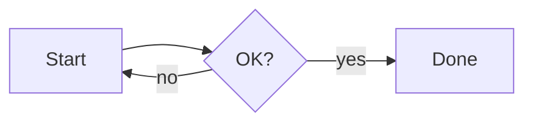
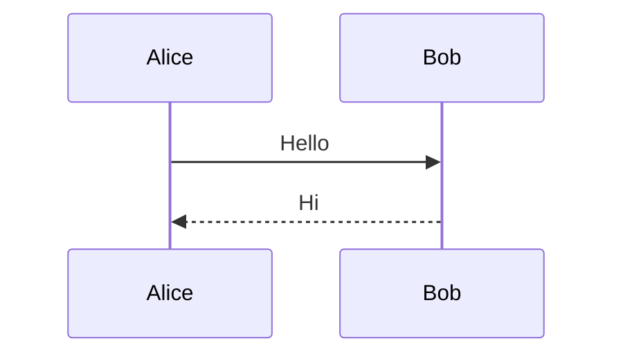
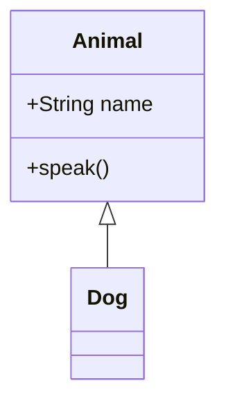
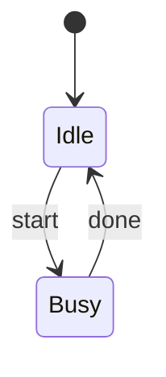
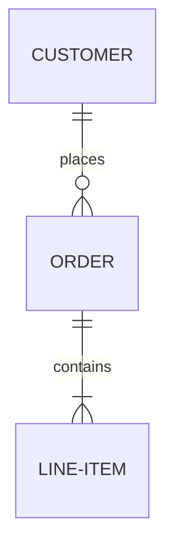
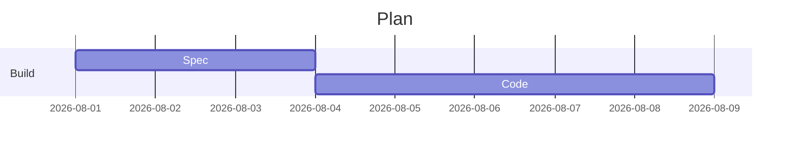
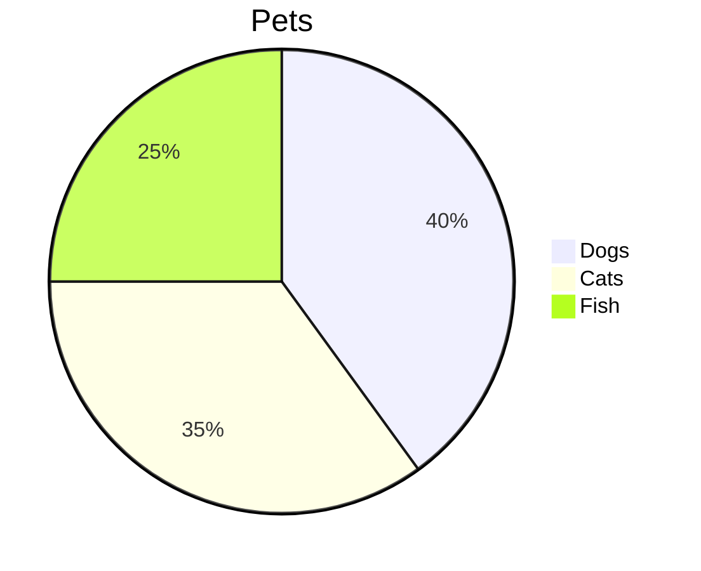
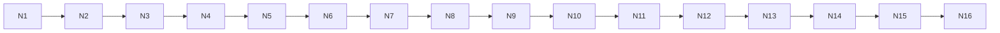

# Quickstart: Validating Mermaid Diagrams & Code Block Enhancements

**Feature**: [spec.md](./spec.md) | **Plan**: [plan.md](./plan.md) | **Contracts**: [contracts/](./contracts/) | **Data model**: [data-model.md](./data-model.md)

Folio has no automated test runner. These manual scenarios are the validation for this feature and cover the constitution's quality gates that apply to it.

## Prerequisites

- A checkout of the repository and Node.js LTS (README: Node 18+).
- `npm install`. The lockfile pins `mermaid` 11.16.1 and `@codemirror/legacy-modes` 6.5.3; `highlight.js` is no longer installed.
- Run the app with `npm start`, which builds a **minified** renderer bundle and launches Folio. `npm start -- <path>` opens a specific file.
- Optional, for V7: Typora with an equivalent Fluent theme, for the side-by-side comparison.

## Fixtures

Create a scratch folder of your choice (for example `~/folio-010-check/`) containing two files.

**`diagrams.md`**: seven valid diagram types, a case/attribute variant, a broken diagram, an empty diagram, a hostile label and a very wide diagram:

````markdown
# Diagram check















```Mermaid title="case and attributes"
graph TD
  X --> Y
```

```mermaid
graph LR
  A -->
```



````

**`code.md`**: fences in several languages and aliases, unsupported and missing languages, edge-case content and one indented block:

````markdown
# Code check

```js
// identifiers are coloured, as in Typora
const answer = compute(42, "x");
function greet(name) { return `Hi ${name}`; }
```

```JS title=app.js
let a = 1;
```

```py
def f(x):
    return x * 2  # comment
```

```sh
echo "$HOME" | grep -v cache
```

```yml
key: value
list: [1, 2]
```

```c#
var s = new StringBuilder();
```

```diff
- removed line
+ added line
```

```php
<?php echo "plain"; ?>
```

```text
<b>not bold</b> & stays literal
```

```
no language here
```

```js
const tail = 1;


```

```

```

    indented code block
````

## Validation scenarios

### V1: Diagrams in the preview (User Story 1; FR-001–FR-003, FR-008, FR-010, FR-031; SC-001)

1. Run `npm start` and choose `Help > Markdown Formatting Tour`. Scroll to **Diagrams**.
   **Expect**: a left-to-right flowchart and a sequence diagram are drawn. No diagram source is visible.
2. `File > Open…` → `diagrams.md`.
   **Expect**: the page text appears at once and the diagrams fill in afterwards, in order. The flowchart, sequence, class, state, ER, Gantt and pie diagrams are all drawn. The ```` ```Mermaid title="case and attributes" ```` block is drawn too. The 16-node flowchart is scaled down to the page width and centred, with no horizontal page overflow.
3. Open `code.md` and then go straight back to `diagrams.md` (`Go > Back`, `Alt+Left` / `Cmd+[`) while the diagrams are still being drawn.
   **Expect**: no diagram ever appears in `code.md`, and `diagrams.md` is drawn completely.

### V2: Appearance and Style redraw (User Story 1; FR-005–FR-007; SC-002)

1. With `diagrams.md` open in **Light**, choose **Themes → Dark**.
   **Expect**: every diagram is redrawn with a dark palette without reopening the document. **Themes → Light** restores the light palette.
2. `File > New Window` (`Ctrl/Cmd+Shift+N`) and open the formatting tour in the new window. Focus the first window and switch the appearance again.
   **Expect**: the diagrams in both windows are redrawn, including the window in the background.
3. Press `Ctrl/Cmd+/` to enter source mode, switch the appearance, then press `Ctrl/Cmd+/` again.
   **Expect**: the diagrams appear in the new palette when the preview returns.
4. Choose **Themes → Microsoft Word**, then **GitHub**, then **Fluent**.
   **Expect**: after each switch the diagrams are redrawn once the theme has loaded, with labels in that Style's body font.
5. Regression only (behaviour owned by [011](../011-system-appearance/spec.md)): choose **Themes → System** and flip the OS appearance.
   **Expect**: the diagrams follow the OS.

### V3: Diagram security (User Story 1 scenario 7; FR-004; Principle III)

1. In `diagrams.md`, find the block with the `` label.
   **Expect**: no dialog appears and no script runs. The node is drawn; its label may be empty, show text, or show a broken-image placeholder. The Console may log a failed load of the bogus image `x`, which is expected.
2. Click node A in that diagram.
   **Expect**: nothing happens. The `click A callback` directive is ignored in strict mode.
3. Follow-up, not a pass/fail item: links declared with `click … href` are still emitted by the diagram engine (see [research.md](./research.md) F7).

### V4: PDF export with diagrams (User Story 2; FR-016, FR-017, FR-023; SC-003)

1. Open `diagrams.md`, press `Ctrl/Cmd+/` to enter source mode, then immediately choose `File > Export to PDF…` and save.
   **Expect**: Folio returns to the preview, the save dialog appears once drawing has settled, and the PDF contains every drawn diagram plus the source-and-message fallbacks, exactly as previewed. No copy buttons appear anywhere in it.
2. Repeat in **Dark** appearance and with Page width **A4** and **US Letter**.
   **Expect**: the diagrams print as previewed, and the page size follows the Page width ([001](../001-markdown-viewer-editor/spec.md), [004](../004-three-axis-theming/spec.md)).
3. Timeout path, by code review because it is impractical to trigger by hand: `doExportPDF()` in `src/main.js` passes `timeoutMs: 20000` with `fallback: true`, and `handleMainRequest('prepare-export')` in `src/renderer/renderer.js` resolves after `whenMermaidSettled()`. See [contracts/ipc-channels.md](./contracts/ipc-channels.md).

### V5: Broken diagrams (User Story 3; FR-012–FR-015; SC-004)

1. In `diagrams.md`, look at the `A -->` block.
   **Expect**: its source is shown as a plain code block, followed by the parser's message in red monospace text with its line breaks kept (typically a parse error with a caret pointing into line 2). Every other diagram is still drawn.
2. Look at the empty block.
   **Expect**: a message is shown instead of an empty area, and there is no copy button.
3. Press `Ctrl/Cmd+/`, change `A -->` to `A --> B`, and press `Ctrl/Cmd+/` again without saving.
   **Expect**: the diagram is drawn from the unsaved text, and the title bar shows the `•` unsaved indicator.
4. Switch to **Dark**.
   **Expect**: the message uses the dark red variant.
5. Hover the fallback code block of a still-broken diagram and click its copy button.
   **Expect**: the diagram source is on the clipboard.

### V6: Copy button (User Story 4; FR-018–FR-023; SC-005, SC-006)

1. Open `code.md` and hover the first `js` fence; then move the pointer away.
   **Expect**: a small copy button appears in the fence's top-right corner and hides again when the pointer leaves.
2. Click the button and paste into a plain-text editor.
   **Expect**: the button shows a check mark (tooltip "Copied") for about 1.4 s. The pasted text is exactly the three code lines, with no trailing line break.
3. Click the `Code check` heading, then press `Tab`.
   **Expect**: focus lands on the first copy button, which becomes visible. `Enter` copies the block, and so does `Space`.
4. Click the copy buttons of two different fences in quick succession.
   **Expect**: both show their confirmation at the same time.
5. Copy the `text` fence and the trailing-blank-lines `js` fence.
   **Expect**: `<b>not bold</b> & stays literal` is pasted verbatim. `const tail = 1;` is pasted with the author's blank lines but without the block's final line break.
6. Hover the whitespace-only fence and the indented code block.
   **Expect**: neither shows a copy button.
7. Press `Ctrl/Cmd+F` and search for `Copy`; toggle the outline (`Ctrl/Cmd+Alt+O`); select text across a fence and copy it.
   **Expect**: no find matches come from buttons (the fixture never contains "Copy"), the outline lists headings only, and the copied selection has no extra text.
8. Optional failure path: in `View > Toggle Developer Tools` → Console, run `navigator.clipboard.writeText = () => Promise.reject(new Error('test'))`, then click a copy button.
   **Expect**: a red "Copy failed" state for about 1.4 s. Close that window afterwards to drop the override.
9. Switch to **Dark** and hover a fence.
   **Expect**: the button uses its dark variant. Its absence from PDFs is covered by V4.

### V7: Typora-identical code colouring (User Story 5; FR-024–FR-030; SC-007–SC-009)

1. Open `code.md` with **Fluent / Light**. In `View > Toggle Developer Tools`, inspect the first fence.
   **Expect**: `<pre class="md-fences"><code class="cm-s-inner language-js">` with `cm-keyword`, `cm-def`, `cm-variable`, `cm-string`, `cm-number` and `cm-comment` spans, and no `hljs` classes. Identifiers such as `answer` and `compute` are coloured, not plain body text. See [contracts/code-fence-highlighting.md](./contracts/code-fence-highlighting.md).
2. If Typora is available, open `code.md` there with the equivalent Fluent theme, side by side.
   **Expect**: each token has the same colour, and the fences have the same font size.
3. Check the ```` ```JS title=app.js ````, `py`, `sh`, `yml`, `c#` and `diff` fences.
   **Expect**: each is coloured as its language. The `diff` removal and addition lines are coloured by the fallback rules, which read the theme's `--color-cm-v` (red) and `--color-cm-string` (green) palette entries.
4. Check the `php`, `text` and no-language fences.
   **Expect**: plain, readable text with every character literal.
5. Switch to **Dark**, then to the **GitHub** and **Microsoft Word** Styles.
   **Expect**: the fence colours follow each theme's code palette, and the dark palette in Dark.
6. Press `Ctrl/Cmd+/`.
   **Expect**: the source editor's colours are unaffected. DevTools shows no `#write .md-fences .cm-*` rule applying inside `#typora-source`.
7. In DevTools, compare the computed `font-size` of `.md-fences > code` with that of its `pre`.
   **Expect**: they are equal, so the size does not compound.
8. By code review: `MAX_TOKENS_PER_LINE = 10000`, together with the zero-width nudge in `runMode()` (`src/renderer/highlight.js`), bounds the work per line.

### V8: Light/Dark × Style sweep (constitution gate 3; SC-001)

For each of the 6 combinations (Fluent, GitHub, Microsoft Word × Light, Dark), open the formatting tour, `diagrams.md` and `code.md`.

**Expect**: both tour diagrams are drawn and legible, the fences are coloured, the copy button is visible on hover with a palette that suits the page, and the diagram-failure message is legible.

### V9: Build gate (constitution gate 1)

1. Run `npm run build:renderer`.
   **Expect**: it completes without esbuild errors and logs `[folio] KaTeX assets copied.` and `[folio] renderer bundle built.`. `src/renderer/bundle.js` is minified, and `bundle.js.map` is emitted.
2. Run `npm run watch:renderer`.
   **Expect**: it logs `[folio] esbuild watching renderer…`, and the bundle is left unminified (readable) for development. Stop it with `Ctrl+C`.

### V10: Offline and IPC review (constitution gate 5; Principle VI; FR-011; SC-009)

1. Disconnect from the network, run `npm start`, and repeat V1 and V7.
   **Expect**: identical results; nothing is fetched remotely.
2. Review the `src/main.js` and `src/preload.js` changes in `1ce68e0` against [contracts/ipc-channels.md](./contracts/ipc-channels.md).
   **Expect**: the only new channel is `appearance-changed` (main → renderer, no payload), and `prepare-export` now waits at most 20 s.
3. Check that the CSP in `src/renderer/index.html` still has `script-src 'self'`.

## Gates not applicable to this feature

- **Unsaved-changes guard**: no flow that replaces a document was added or changed. V5 step 3 confirms that diagrams render from unsaved text.
- **`npm run dist`**: no packaging, file-association or launch change.

## Traceability

| Scenario | Stories | Requirements | Success criteria |
| -------- | ------- | ------------ | ---------------- |
| V1 | US1 | FR-001–003, FR-008–010, FR-031 | SC-001 |
| V2 | US1 | FR-005–007 | SC-002 |
| V3 | US1 | FR-004 | — |
| V4 | US2, US4 | FR-016, FR-017, FR-023 | SC-003 |
| V5 | US3, US4 | FR-012–015, FR-018 | SC-004 |
| V6 | US4 | FR-018–023 | SC-005, SC-006 |
| V7 | US5 | FR-024–030 | SC-007, SC-008, SC-009 |
| V8 | US1, US4, US5 | FR-005, FR-023, FR-027 | SC-001 |
| V9 | — | (gate 1) | — |
| V10 | — | FR-011 | SC-009 |
