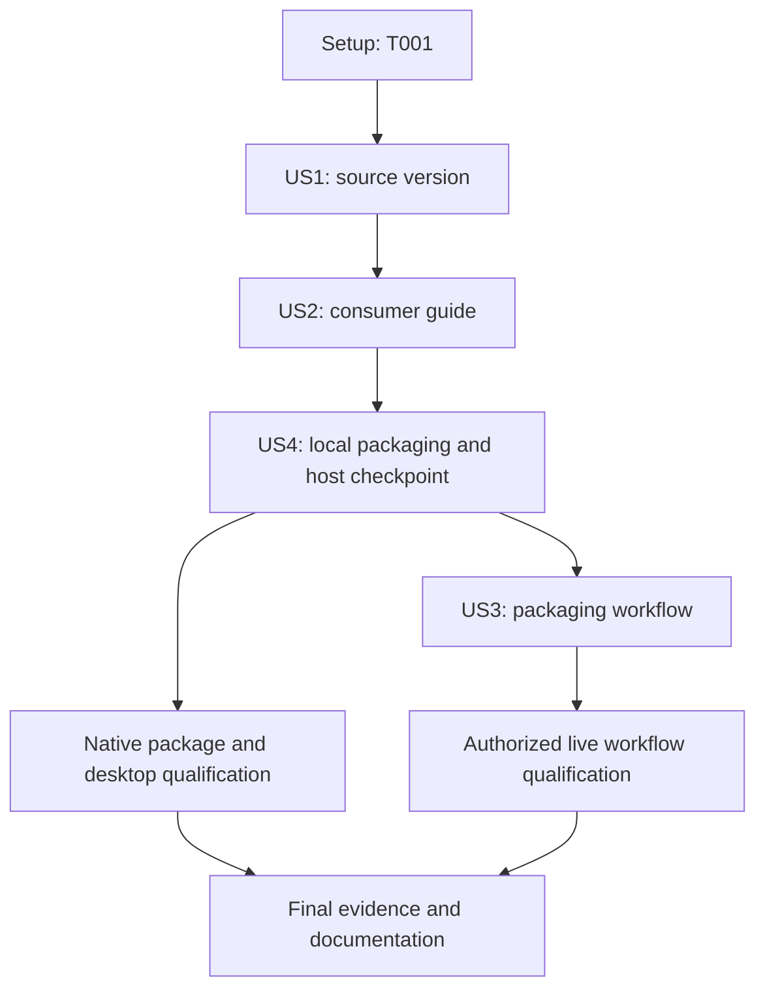

# Tasks: Product Version, Consumer Guide, and Automated Cross-Platform Packages

**Input**: [plan.md](./plan.md), [spec.md](./spec.md), [research.md](./research.md), [data-model.md](./data-model.md), [contracts](./contracts/), and [quickstart.md](./quickstart.md).

**Organization**: US1 and US2 are the two product deliverables.
Implement US4's local packaging before US3's workflow because both are P2 and automation must reuse working local commands.
This dependency ordering does not change the story IDs or priorities.

**Validation scope**: Follow FR-018, the constitution's existing gates, and the plan's focused `node:test` fixture checks.
Do not introduce another test framework or a broader test campaign.
For new helper behavior, establish failing cases before implementing the corresponding behavior and rerun them after the change.
Native package and GUI checks are distinct from unit checks and workflow-source inspection.

## Format: `[ID] [P?] [Story] Description`

- `[P]` identifies file-disjoint work with no dependency on the other work in its parallel group.
- `[US1]` through `[US4]` refer to the specification's user stories.
- Each unchecked task is implementation or qualification work, not work performed by generating this document.
- File paths are repository-relative; feature-document paths start with `specs/012-automate-platform-packaging/`.

## Path Conventions

Keep the existing single application in `src/`, packaging configuration in `package.json`, and orchestration in `scripts/`.
New paths are limited to those selected by the plan, including `docs/user/README.md`, `build/windows/folio.iss`, and `.github/workflows/package.yml`.
Generated packages remain under ignored `release/`.
Do not modify generated renderer assets by hand.

## Phase 1: Setup (Existing Repository)

**Purpose**: Establish a safe baseline without scaffolding another project or installing unrelated tooling.

- [X] T001 Inspect `package.json`, `package-lock.json`, `src/main.js`, `src/store.js`, and existing `scripts/` against `specs/012-automate-platform-packaging/plan.md`; record the baseline source revision, product/runtime versions, host architecture, Node availability, and relevant existing user changes in the execution record referenced by `specs/012-automate-platform-packaging/quickstart.md`.

---

## Phase 2: Foundational (Blocking Prerequisites)

**Purpose**: Reuse the application and build infrastructure already present.

No new shared service, database, framework, or project bootstrap is required.
T001 is the shared baseline prerequisite.
Version changes belong to US1; the guide belongs to US2; distribution-only helpers belong to US4.
Do not move those deliverables into an infrastructure phase or create the workflow before the first two product checkpoints.
The NSIS-to-Inno exception is already justified in `plan.md`; preserve that explicit exception rather than silently rewriting the constitution.

**Checkpoint**: Baseline understood; start the product changes.

---

## Phase 3: User Story 1 - Update the Product Version Independently of Automation (Priority: P1)

**Goal**: Declare product version `1.0.0` in source and prove that local Folio consumes it without a workflow.

**Independent Test**: The three product-version declarations match, About Folio shows `1.0.0`, and a locally produced package reflects it without changing source metadata.
Later-version fixtures are covered in US4, not by changing the real product again.

### Implementation and Validation

- [X] T002 [US1] Update `package.json` and the root and `packages[""]` product-version entries in `package-lock.json` from `0.1.0` to `1.0.0` using `npm version 1.0.0 --no-git-tag-version --ignore-scripts`; enforce "Valid product SemVer from root `package.json`; initially changed once to `1.0.0`." Preserve "Existing npm name `folio`; preserve it so settings identity does not move.", "Existing build product name `Folio`.", and "Existing application ID `com.dpokluda.folio`."
- [X] T003 [US1] Refresh only the Electron resolution in `package-lock.json` from `43.7.7` to researched `43.8.1` within the existing `package.json` major-43 range, retain builder `26.15.3`, and restore the changed lockfile with the selected supported Node toolchain; do not perform unrelated dependency upgrades or migrate to builder v27.
- [X] T004 [P] [US1] Correct the contributor toolchain guidance in `README.md` to recommend Node 24 LTS and acknowledge Electron's `>=22.12.0` requirement, preserving existing troubleshooting, non-affiliation prose, and acknowledgements; do not add a pipeline-owned product-version setting.
- [X] T005 [US1] Run the US1 local checks in `specs/012-automate-platform-packaging/quickstart.md` using `package.json`, `package-lock.json`, `npm start`, and the existing host packaging command; confirm source versions, About output, and local package metadata agree and record actual results without claiming other platforms were checked.

**Checkpoint**: US1 is independently usable.
The product version is source-controlled; no workflow exists to set or increment it.

---

## Phase 4: User Story 2 - Learn to Use Folio from a Short Local Guide (Priority: P1)

**Goal**: Ship a maintained consumer README and make it readable offline through the existing application.

**Independent Test**: Build locally without GitHub Actions, remove the original installation medium, and open the bundled guide through Help.
Save/Discard/Cancel behavior and Save As for guide edits must preserve user work and the shipped copy.

### Implementation and Validation

- [X] T006 [P] [US2] Author `docs/user/README.md` as "`docs/user/README.md`, authored before automation." Cover the existing consumer workflows, shortcuts, settings location, first launch, removal, license, and command-install limitations from `specs/012-automate-platform-packaging/contracts/user-guide.md`; avoid contributor setup, network-dependent instructions, and claims that not-yet-added package forms are already available.
- [X] T007 [P] [US2] Add guide resolution and `Help > User Guide` in `src/main.js` and `src/menu.js`, using "`Help > User Guide`, offline, through the guarded built-in document path." Preserve "Untitled buffer; saving requires Save As and cannot overwrite the shipped guide.", the existing focused-session/dirty-check flow, and explicit read errors; add no new filesystem IPC or viewer.
- [X] T008 [P] [US2] Extend `package.json` resource selection to install "`README.md` in the application's ordinary resources directory." Copy the authored guide and root `LICENSE` to ordinary resources on all platforms, retaining existing themes and the macOS document icon; do not generate or rewrite the guide during packaging.
- [X] T009 [P] [US2] Link the consumer guide and document its Help access in `README.md`, retaining the repository's existing contributor material and required disclaimer/credits; keep consumer instructions separate from build instructions.
- [X] T010 [US2] Execute the US2 development and host-package scenarios in `specs/012-automate-platform-packaging/quickstart.md`, including offline Help access, media removal, missing-guide errors, Save/Discard/Cancel, guide Save As, Light/Dark, and affected style families; record the local source version and guide as working before any workflow is created.

**Checkpoint**: US1 and US2 form the product MVP and satisfy SC-008 on the checked host.
They work without CI.
Archive/new-installer instructions are completed alongside those implementations in T023.

---

## Phase 5: User Story 4 - Choose an Installable Package or an Archive (Priority: P2)

**Goal**: Extend the same local packaging commands to produce complete native archives and distribution packages, with reliable inspection and safe installation.

**Independent Test**: On each matching native target, run the local packaging command, inspect both actual outputs, and launch them.
The host checkpoint below enables workflow authoring; it does not claim that all twelve package forms have passed desktop acceptance.
Full native qualification remains explicit in the final phase and can use matching local builds without CI.

### Implementation and Focused Checks

- [X] T011 [US4] Add the already locked `semver` `7.8.5` and `@electron/asar` `3.4.1` as explicit development dependencies in `package.json` and `package-lock.json`, preserving unrelated resolutions and adding no runtime dependency or test framework.
- [X] T012 [US4] Establish focused failing fixtures in `tests/packaging.test.js` with `node:test` for the planned metadata, naming, compiler, and verifier interfaces: mismatched lockfile data, invalid/unrepresentable SemVer, missing guide, future version `1.1.0`, wrong CPU headers, missing output/resources, nonzero tool statuses, and paths with spaces/non-ASCII characters; keep fixtures temporary and never mutate the real product to simulate a later version.
- [X] T013 [US4] Implement `scripts/package-metadata.js` with the JSON/default and `--version` CLI contract: validate "Root `package-lock.json.version`; must equal `version`, not the unrelated lockfile format number.", "Lockfile `packages[""].version`; must equal `version`.", and "Locked `node_modules/electron` package version, not the product version." Enforce "The workflow treats all fields as read-only inputs." and "Missing, invalid, inconsistent, or platform-unrepresentable version data is an error, never a fallback to `1.0.0`."; derive the exact six-target package names and make the relevant T012 cases pass.
- [X] T014 [US4] Add shared metadata/guide/asset preflight to `scripts/run-electron-builder.js` before packaging, preserving argument forwarding, `scripts/ensure-electron.js`, `scripts/clean-release.js`, original diagnostics, and the existing three-attempt rcedit-only retry; cover invalid input and non-retryable failure propagation in `tests/packaging.test.js`.
- [X] T015 [US4] Configure `package.json` for Windows ZIP, macOS DMG plus tar.gz, and Linux AppImage plus tar.gz plus existing local deb, using exact platform/version/architecture names from `specs/012-automate-platform-packaging/contracts/packaging.md`; copy Windows `resources/document.ico`, exclude Word TTF files from both theme copies, retain offline assets, and use the selected v26 ad-hoc macOS signing settings without notarization.
- [X] T016 [P] [US4] Create `build/windows/folio.iss` with macro inputs `ProductVersion`, `TargetArch`, `PayloadDir`, and `OutputDir`; enforce "`com.dpokluda.folio`, stable across versions and both architectures.", "Current user only.", and "`%LOCALAPPDATA%\Programs\Folio`." Use Inno `6.7.3`, `PrivilegesRequired=lowest`, matching architecture/64-bit mode, Start menu/uninstall support, same-version file replacement, and graceful rather than forced app closure.
- [X] T017 [US4] Complete shell registration and legacy-install detection in `build/windows/folio.iss`: preserve "Existing `Folio.Markdown`; preserve the five declared extensions and document icon.", use the quoted executable/file command and ordinary icon, and enforce "Inno-owned `com.dpokluda.folio_is1` registration; no adoption of an NSIS uninstall record." Detect "`9f5ff8db-51b6-575b-9468-75de01a1e384`, checked in relevant user/machine registry views.", stop for deliberate NSIS removal, and preserve "Existing Electron `userData` and user documents; never installer-owned cleanup targets."
- [X] T018 [US4] Implement `scripts/build-inno-installer.js` and register its `afterAllArtifactBuild` hook in `package.json`; consume only current-invocation Windows ZIP results, verify matching native `Folio.exe`, resolve a verified `ISCC_PATH`/local compiler without auto-installation, pass T016's macros, and return only successfully compiled nonempty setup paths. Preserve unpacked-only `--dir` without an Inno requirement and exercise compiler/error/output cases in `tests/packaging.test.js`.
- [X] T019 [US4] Implement the shared CLI, extraction, inspection, and staging core in `scripts/verify-packages.js` with fixtures in `tests/packaging.test.js`; enforce "Only these target keys are accepted by the new verifier." for `windows-x64`, `windows-arm64`, `linux-x64`, `linux-arm64`, `macos-x64`, and `macos-arm64`, normalize PE/ELF/Mach-O CPU identifiers, and require "Packaged bytes match the guide read from that checked-out source." Verify source/locked-runtime versions, complete resources/license/offline assets, both font exclusions, and exactly two allowed staged payloads after successful requested checks.
- [X] T020 [US4] Add Windows ZIP and Inno verification to `scripts/verify-packages.js` and `tests/packaging.test.js`: refuse existing Folio installations/owned shell registrations/conflicting shortcuts, use a clean test account and owned temporary destination, inspect installed app architecture/resources/registration, perform bounded native probes and silent uninstall, and never adopt or remove a pre-existing installation.
- [X] T021 [US4] Add macOS tar.gz and DMG verification to `scripts/verify-packages.js` and `tests/packaging.test.js`, preserving the complete app bundle, symlinks and executable modes; inspect actual mounted/copied DMG payloads, run bounded native/signature checks, and detach only owned mounts without masking an earlier failure.
- [X] T022 [US4] Add Linux tar.gz/AppImage verification and Linux-only `--fedora 44` handling to `scripts/verify-packages.js` and `tests/packaging.test.js`; probe both actual extracted payloads in matching `fedora:44` containers before cleanup/staging, map `x64` to Docker `amd64`, record image digests, verify `libfuse.so.2` providers, reject unsupported flag/platform/release combinations, and clean up only owned resources without disabling the application sandbox.
- [X] T023 [US4] Update `README.md`, `docs/user/README.md`, and affected `scripts/build.ps1` help to match the now-implemented package names, complete archive contents, Inno prerequisite/transition, ad-hoc-versus-notarized macOS behavior, Linux `./folio`/FUSE instructions, optional shell-launcher cleanup, and preserved local deb support; keep unsupported cross-host Inno compilation explicit.
- [X] T024 [US4] Run `node --test tests/packaging.test.js`, `npm run build:renderer`, the host's local `dist` command, and `scripts/verify-packages.js` as specified in `specs/012-automate-platform-packaging/quickstart.md`; snapshot manifests/guide before building and prove they remain unchanged, including during an unpacked-only build. Record checked targets and leave other native qualification explicitly unverified.

**Checkpoint**: Local packaging implementation and host validation are ready to be reused by CI.
Do not equate that checkpoint with all-platform GUI acceptance.

---

## Phase 6: User Story 3 - Get a Complete Package Set after Each Main Push (Priority: P2)

**Goal**: Automate the prepared product's existing packaging and validation for all six targets without taking ownership of its version or guide.

**Independent Test**: After an authorized normal update to `main`, one run provides twelve directly downloadable package artifacts from that exact revision.
Failures propagate, reruns retain provenance, and no release/tag/source mutation occurs.
Source inspection alone is not this live acceptance test; T031 records the actual run.

### Implementation and Validation

- [X] T025 [P] [US3] Create `.github/scripts/setup-inno.ps1` to obtain official Inno Setup `6.7.3` using the exact versioned asset in `specs/012-automate-platform-packaging/research.md`, verify SHA-256 `9c73c3bae7ed48d44112a0f48e66742c00090bdb5bef71d9d3c056c66e97b732` and valid signer `Pyrsys B.V.`, install only into an owned runner-temporary current-user directory, and expose verified `ISCC_PATH`; fail on any mismatch without elevation, signing credentials, or compiler-version fallback.
- [X] T026 [P] [US3] Create the trigger, pinned first-party actions, and six-job native matrix in `.github/workflows/package.yml` using `windows-2022`, `windows-11-arm`, `ubuntu-24.04`, `ubuntu-24.04-arm`, `macos-15-intel`, and `macos-15`; select matching Node 24 architectures, assert runner/Node architecture, use `contents: read`, disable persisted checkout credentials, cache npm downloads only, and keep `fail-fast: false`, a 45-minute timeout, and no latest-only concurrency cancellation.
- [X] T027 [US3] Complete `.github/workflows/package.yml` with Windows compiler provisioning, `npm ci`, helper checks, exact local packaging commands and `--publish never`, verifier calls including Linux `--fedora 44`, source immutability checks, and twelve single-file artifact uploads using `archive: false` and actual package filenames, following Anniversary. Stage only the validated two-file allowlist per target, keep immutable artifact IDs and source/run provenance in summaries, use no overwrite/repository retention, and fail for missing outputs or upload errors; never bump versions, generate guides, publish releases, or create/move tags.
- [X] T028 [P] [US3] Add end-user artifact-download instructions to `README.md`, explaining the Actions run, twelve direct-file downloads, source/run provenance, sign-in/access requirements, retention expiry, and legacy outer transport ZIPs; point to the authored consumer guide without describing artifacts as permanent anonymous releases.
- [X] T029 [US3] Review `.github/workflows/package.yml` and `.github/scripts/setup-inno.ps1` against `specs/012-automate-platform-packaging/contracts/workflow.md`, validate syntax with available tooling, rerun relevant fixture checks in `tests/packaging.test.js`, and record source-level results in `specs/012-automate-platform-packaging/quickstart.md`; verify future-version and failure/rerun behavior without pushing broken inputs to `main` or claiming a live run.

**Checkpoint**: Workflow source is ready.
Live qualification still requires an authorized push/merge, not an automatic push by the implementing agent.

---

## Phase 7: Polish & Cross-Cutting Qualification

**Purpose**: Close the actual acceptance evidence without confusing authored code, inspected archives, native probes, and GUI checks.

- [X] T030 Run the affected regression gates from `specs/012-automate-platform-packaging/quickstart.md` against `src/main.js`, `src/menu.js`, `build.js`, and `tests/packaging.test.js`; confirm existing Welcome/Formatting Tour, unsaved guards, themes, settings, file/folder launch, renderer build, and local packaging behavior remain intact, with actual failures/blockers recorded.
- [ ] T031 After a user-authorized normal update to `main`, inspect `.github/workflows/package.yml`'s real run and downloaded artifacts using the commands in `specs/012-automate-platform-packaging/quickstart.md`; establish six successful native jobs/twelve payload files, exact source version/commit, source immutability, no release/tag changes, and legitimate rerun identity. If authorization or a real run is unavailable, leave this task unchecked and report the blocker rather than pushing automatically.
- [ ] T032 Execute the twelve-form desktop matrix in `specs/012-automate-platform-packaging/quickstart.md` on Windows 11, macOS 15, and Fedora 44 for x64/arm64 using matching native packages, whether already built locally or obtained from authorized CI; verify launch, file/folder opening, source editing/save, search, themes, PDF, another window, offline assets, guide access after media removal, and actual AppImage FUSE mounting. Record `Pass`, `Fail`, or `Not run` separately for every package form.
- [ ] T033 Qualify `build/windows/folio.iss` on disposable genuine standard-user Windows x64/arm64 environments and record results in `specs/012-automate-platform-packaging/quickstart.md`: verify legacy NSIS uninstall-then-install, same-version replacement, later-version upgrade, uninstall, document icons/quoted paths/default-handler preservation, and refusal to force-close dirty Folio. Use disposable copied source for later-version fixtures, keep the real declared product version unchanged, and preserve documents/settings throughout.
- [ ] T034 Audit all twelve actual distributions against `package.json` and `specs/012-automate-platform-packaging/contracts/packaging.md` for complete runtime/resources, guide/license bytes, dependency notices, and absence of restricted fonts in both theme copies; prove the exclusion with a dummy TTF in a disposable fixture rather than redistributing a real personal font, and record the evidence in `specs/012-automate-platform-packaging/quickstart.md`.
- [ ] T035 Verify the preserved local command contracts in `scripts/build.ps1`, `scripts/run-electron-builder.js`, and `src/main.js`, including Linux default deb generation with its documented prerequisites, compiler-free `--dir`, optional existing `folio` command installation, and unchanged archive settings behavior; record unavailable native checks as blockers in `specs/012-automate-platform-packaging/quickstart.md`, not as successful coverage inferred from another OS.
- [ ] T036 Finalize `README.md`, `docs/user/README.md`, and `specs/012-automate-platform-packaging/quickstart.md` using the actual qualified OS/runtime versions, verified Fedora packages and signing/first-launch behavior; distinguish upstream minimum requirements from tested reference systems, keep instructions concise, and retain non-affiliation and licensing credits.
- [ ] T037 Review FR-001 through FR-019 and SC-001 through SC-008 in `specs/012-automate-platform-packaging/spec.md` against the implemented files and recorded evidence; resolve task-caused gaps, preserve unrelated work, leave blocked qualification tasks unchecked, and mark the feature implemented only when its required evidence exists. Do not stage, commit, tag, switch branches, or push without an explicit user request.

---

## Dependencies & Execution Order

### Story-Level Dependencies



US4 precedes US3 because their shared P2 priority permits dependency ordering and CI must reuse local packaging.
The workflow is never a prerequisite for the source-version/guide MVP.
Native US4 qualification can use local native builds; CI is a convenient source of the matrix, not the only possible source.
Live CI and hardware qualification are completion gates, not permission to provision shared machines or push code automatically.

### Direct Task Dependencies

Every unlisted relationship is independent; task number alone does not establish a dependency.
The table includes shared-file sequencing as well as functional prerequisites.

| Task(s) | Direct prerequisites |
| --- | --- |
| T001 | None. |
| T002 | T001. |
| T003 | T002; shared manifest/lockfile sequencing. |
| T004 | T001; independent README edit. |
| T005 | T003, T004. |
| T006, T007, T008, T009 | T005; file-disjoint product-guide work. |
| T010 | T006, T007, T008, T009. |
| T011 | T010. |
| T012 | T011. |
| T013 | T012. |
| T014 | T013. |
| T015 | T011; shared manifest sequencing after dependency declaration. |
| T016 | T010; installer macro interface is fixed above. |
| T017 | T016; same installer file. |
| T018 | T013, T014, T015, T017. |
| T019 | T018; includes sequencing of shared fixture-file edits. |
| T020 | T019. |
| T021 | T020; same verifier and fixture files. |
| T022 | T021; same verifier and fixture files. |
| T023 | T015, T017, T018, T022. |
| T024 | T022, T023. |
| T025, T026, T028 | T024; file-disjoint CI/documentation work. |
| T027 | T025, T026. |
| T029 | T027, T028. |
| T030 | T029. |
| T031 | T030 and an authorized normal push/merge to `main`. |
| T032 | T024 and availability of all matching native package pairs/test environments. |
| T033 | T017 and disposable native Windows environments/packages. |
| T034 | T024, all twelve package payloads, and a disposable exclusion fixture. |
| T035 | T024 and the relevant native environments/prerequisites. |
| T036 | T030, T031, T032, T033, T034, T035. |
| T037 | T036. |

Qualification tasks share the evidence document.
Serialize updates to `quickstart.md` even if people perform independent checks concurrently.
If an external prerequisite is unavailable, preserve its unchecked task and report the exact blocker; do not silently drop an architecture or qualification case.

### Parallel Opportunities

Nine tasks are marked `[P]`.
These markers describe safe file-level opportunities, not an instruction to spawn agents or sessions.
Keep all shared-manifest, installer, verifier, workflow, and fixture-file edits ordered as shown above.

## Parallel Example: User Story 1

```text
After T001:
  T002 -> T003: package.json and package-lock.json
  T004: README.md contributor prerequisites
Join at T005.
```

## Parallel Example: User Story 2

```text
After T005:
  T006: docs/user/README.md
  T007: src/main.js and src/menu.js
  T008: package.json ordinary resources
  T009: README.md guide access
Join at T010.
```

The source/resource paths and Help behavior are fixed by the contracts, so those edits do not require another task's unfinished content.
Do not run their integration check until all four are complete.

## Parallel Example: User Story 4

```text
After T010:
  T011 -> T012 -> T013 -> T014: helper dependencies, fixtures, metadata, preflight
  T015 after T011: package.json targets/resources
  T016 -> T017: build/windows/folio.iss
Join at T018.
```

T015 and the metadata/preflight implementation use different files after T011.
Keep T019 through T022 serial because they extend the same verifier and test file.

## Parallel Example: User Story 3

```text
/After T024:
  T025: .github/scripts/setup-inno.ps1
  T026: .github/workflows/package.yml trigger/matrix
  T028: README.md artifact downloads
Join T025 and T026 at T027; join T027 and T028 at T029.
```

T026 establishes the workflow skeleton; T027 integrates the completed provisioning helper and packaging/verification/upload steps.
Do not edit the workflow simultaneously in T026 and T027.

---

## Implementation Strategy

### MVP First

US1 is the first independently useful increment.
US1 plus US2 is the recommended product MVP: source version `1.0.0` and a usable installed consumer guide, with no pipeline dependency.
Stop at each checkpoint to validate, not to omit the remaining requested work.

### Incremental Delivery

1. Establish T001's baseline without scaffolding or changing Git state.
2. Complete US1 and confirm the source-controlled version locally.
3. Complete US2 and prove the version and installed guide work before automation.
4. Complete US4's packaging implementation and host checkpoint, then reuse those exact commands in US3.
5. Perform authorized live CI and native qualification, update evidence, and close the final requirement audit.

### Scope and Safety

All implementation tasks start unchecked.
Generating this file does not authorize dependency installation, application installation, live CI execution, repository publication, or infrastructure provisioning now.
During implementation, change manifests before restoring dependencies and use existing tooling unless an actual missing-tool failure requires another tool.
Never commit merely to make a clean-diff validation command pass; use pre-build snapshots for uncommitted local work.
No phase automatically creates a branch, commit, tag, pull request, or push.
No green container probe or administrative hosted account is described as a passed consumer desktop/standard-user check.
